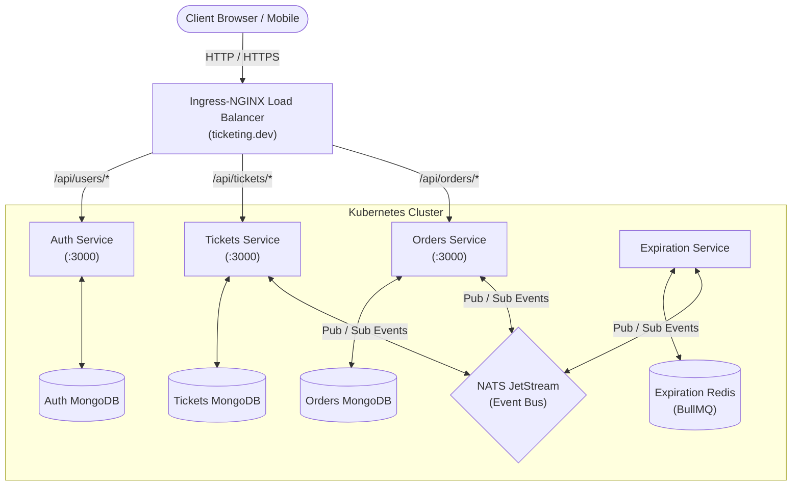

# Booking Service Backend (Microservices Architecture)

A robust, production-grade, event-driven ticketing and booking platform built with **Node.js**, **Express**, **TypeScript**, **NATS JetStream**, **MongoDB**, **Redis**, **Docker**, and **Kubernetes**.

---

## 🏛 Architecture Overview

The system is designed following the **Database-per-Service** pattern, decoupling business domains into autonomous microservices that communicate asynchronously using **NATS JetStream** events.



---

## 📦 Services Breakdown

| Service | Technology | Primary Responsibilities |
| :--- | :--- | :--- |
| **`common/`** | TypeScript, npm | Shared internal package containing custom error classes, auth middlewares, NATS publisher/listener base classes, and domain types (`OrderStatus`). |
| **`auth/`** | Node.js, Express, MongoDB | User signup, signin, signout, current user validation, password hashing (scrypt), and JWT cookie sessions. |
| **`tickets/`** | Node.js, Express, MongoDB | Ticket creation, editing, pricing, and locking via `orderId` association during active reservations. |
| **`orders/`** | Node.js, Express, MongoDB | Central order orchestrator: reserves tickets, tracks status (`Created`, `Cancelled`, `AwaitingPayment`, `Completed`), and handles order cancellation. |
| **`expiration/`** | Node.js, BullMQ, Redis | Asynchronous timer service: manages a 15-minute countdown queue for unpaid orders and emits expiration events. |
| **`infra/k8s/`** | Kubernetes, NGINX Ingress | Declarative deployments, cluster services, and ingress reverse proxy configurations. |

---

## 🔄 Event-Driven Booking Lifecycle

```
[ User purchases Ticket ]
            │
            ▼
     [ orders-service ]
            │
            ├──► Publishes `order.created` ──────► [ tickets-service ] (locks ticket by setting `orderId`)
            │
            └──► Publishes `order.created` ──────► [ expiration-service ] (enqueues 15-min delayed job in BullMQ)
                                                            │
                                                     (Timer expires)
                                                            │
     [ orders-service ] ◄── Publishes `expiration.complete` ┘
            │
            ├── Updates order status to `Cancelled`
            │
            └──► Publishes `order.cancelled` ────► [ tickets-service ] (unlocks ticket by clearing `orderId`)
```

### Event Subjects

| Event Subject | Publishing Service | Consuming Services | Payload Summary |
| :--- | :--- | :--- | :--- |
| `ticket.created` | `tickets` | `orders` | `{ id, title, price, userId, version }` |
| `ticket.updated` | `tickets` | `orders` | `{ id, title, price, userId, version, orderId? }` |
| `order.created` | `orders` | `tickets`, `expiration`, `payments` | `{ id, version, userId, status, expiresAt, ticket: { id, price } }` |
| `order.cancelled` | `orders` | `tickets`, `payments` | `{ id, version, ticket: { id } }` |
| `expiration.complete` | `expiration` | `orders` | `{ orderId }` |
| `payment.created` | `payments` | `orders` | `{ id, orderId, stripeId }` |

---

## 🚀 API Endpoints

### Authentication (`/api/users`)
- `POST /api/users/signup` – Register a new account (`email`, `password`)
- `POST /api/users/signin` – Authenticate user and receive JWT session cookie
- `GET /api/users/currentuser` – Retrieve details of authenticated user
- `POST /api/users/signout` – Clear session cookie

### Tickets (`/api/tickets`)
- `POST /api/tickets` – Create a new ticket (`title`, `price`) [Protected]
- `GET /api/tickets` – List all unreserved tickets
- `GET /api/tickets/:id` – Fetch a specific ticket by ID
- `PUT /api/tickets/:id` – Update ticket title or price (only ticket creator, when unlocked) [Protected]

### Orders (`/api/orders`)
- `POST /api/orders` – Create an order reservation for a ticket (`ticketId`) [Protected]
- `GET /api/orders` – List all orders belonging to the authenticated user [Protected]
- `GET /api/orders/:id` – Fetch details of a specific order [Protected]
- `DELETE /api/orders/:id` – Cancel an existing order [Protected]

---

## 🛠 Local Development & Testing

### Prerequisites
- [Node.js](https://nodejs.org/) (v18+)
- [Docker](https://www.docker.com/) & [Kubernetes](https://kubernetes.io/) (Docker Desktop or Minikube)
- [Ingress-NGINX Controller](https://kubernetes.github.io/ingress-nginx/)

### 1. Build Shared Package
```bash
cd common
npm install
npm run build
```

### 2. Run Tests
Each microservice has its own isolated Jest test suite:

```bash
# Test tickets service
cd tickets && npm test

# Test orders service
cd orders && npm test

# Test expiration service
cd expiration && npm test
```

### 3. Deploy to Kubernetes
Ensure your local hosts file (`/etc/hosts`) maps `127.0.0.1` to `ticketing.dev`:

```bash
127.0.0.1 ticketing.dev
```

Create required secrets:
```bash
kubectl create secret generic jwt-secret --from-literal=JWT_SECRET_KEY=your_secret_key
```

Apply all Kubernetes manifests:
```bash
kubectl apply -f infra/k8s/
```

---

## 📄 License
ISC License
