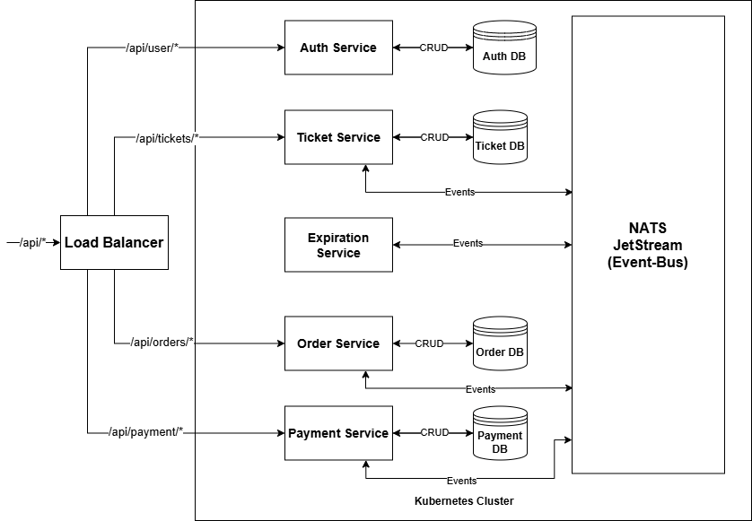
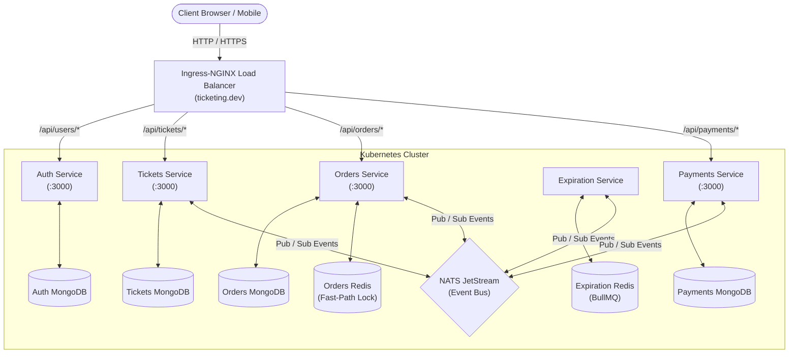
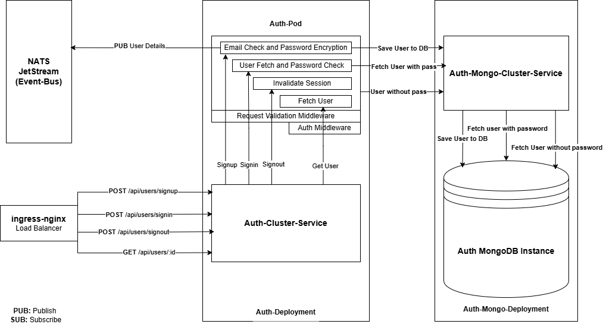
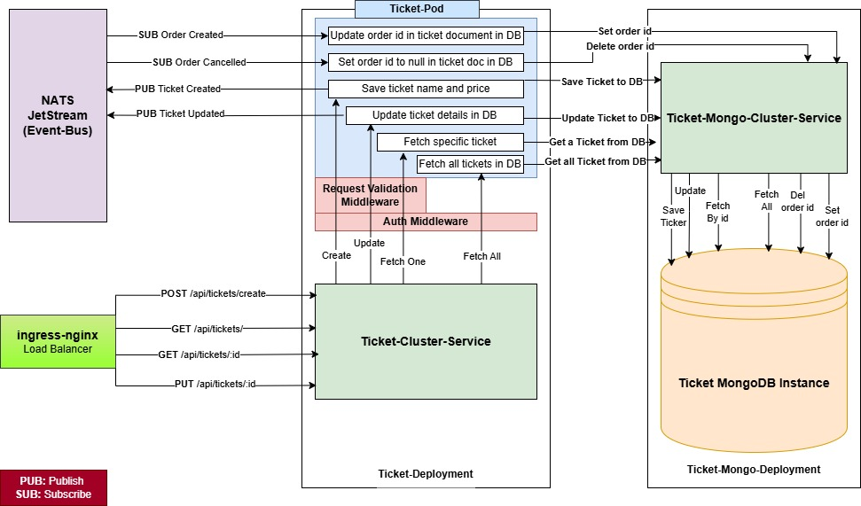
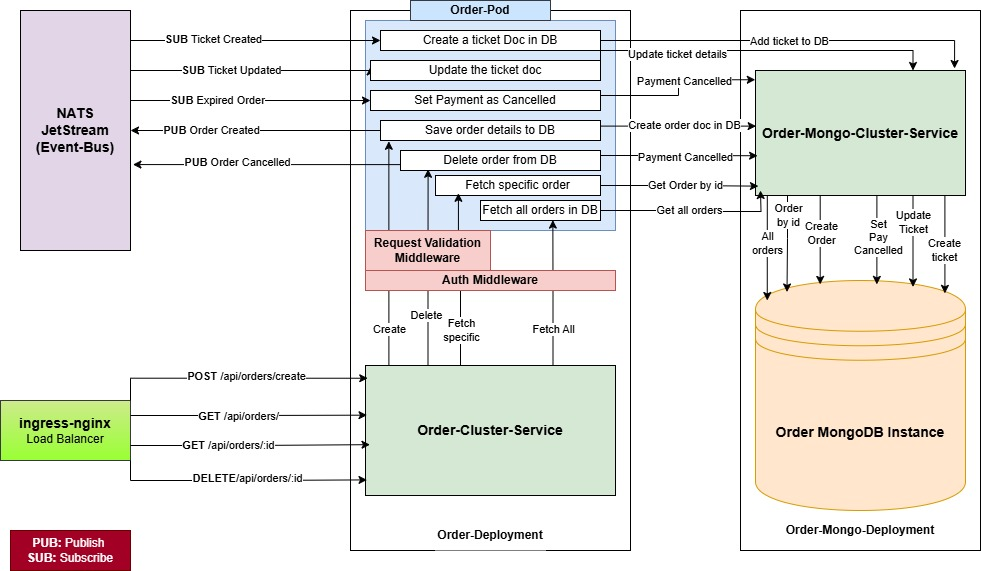
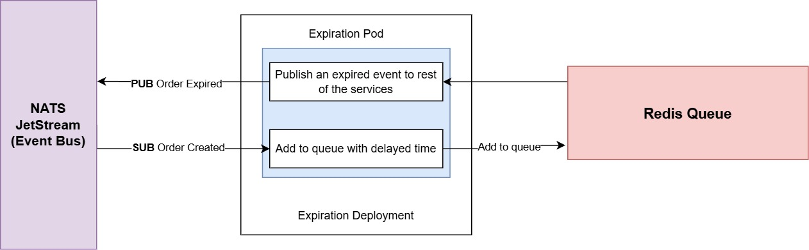
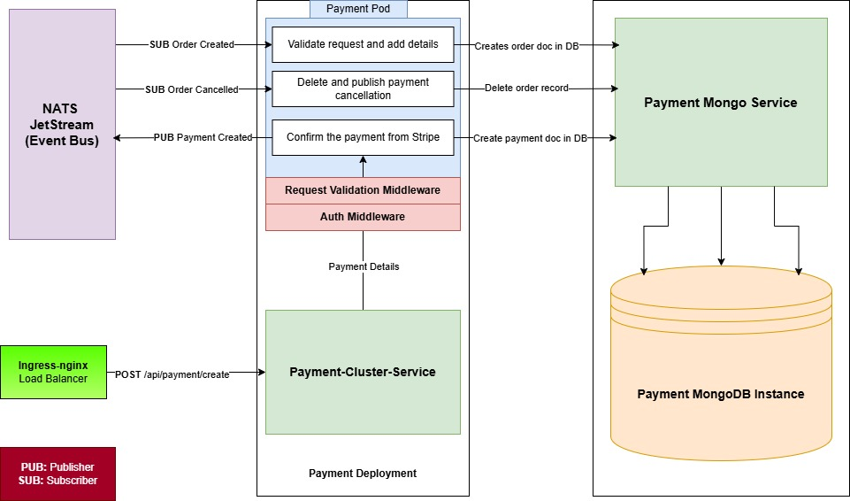

# Ticketing Microservices

This repository contains a production-grade, event-driven ticketing and booking microservices platform built using **Node.js**, **TypeScript**, **MongoDB**, **Redis**, **NATS JetStream**, **Stripe**, **Docker**, and **Kubernetes**. The application is designed to manage high-concurrency ticket sales, order reservations, secure payments, and user authentication in a scalable and fault-tolerant manner.

---

## Table of Contents
- [Architecture](#architecture)
- [Services](#services)
- [Technologies](#technologies)
- [Getting Started](#getting-started)
- [Environment Variables](#environment-variables)
- [Running the Application](#running-the-application)
- [Testing](#testing)
- [Deployment](#deployment)
- [Contributing](#contributing)

---

## Architecture

The system follows a **Database-per-Service** microservices architecture, decoupling business domains into autonomous services that communicate asynchronously through **NATS JetStream** events:

- **Auth Service**: Handles user authentication, password hashing, and session management.
- **Tickets Service**: Manages ticket creation, editing, pricing, and reservation locking.
- **Orders Service**: Orchestrates ticket reservations with an atomic in-memory Redis lock.
- **Expiration Service**: Manages a 15-minute countdown queue for unpaid orders using BullMQ.
- **Payments Service**: Processes credit card transactions via Stripe and completes orders.
- **Common Module**: Centralized shared package (`@ksticketinservice/common`) for error classes, middlewares, and event schemas.



### Architecture Topology



### Event-Driven Booking Lifecycle

```
[ User purchases Ticket ]
            │
            ▼
     [ orders-service ]
            │
            ├──► Publishes `order.created` ──────► [ tickets-service ] (locks ticket by setting `orderId`)
            ├──► Publishes `order.created` ──────► [ payments-service ] (replicates order projection in DB)
            └──► Publishes `order.created` ──────► [ expiration-service ] (enqueues 15-min delayed job in BullMQ)
                                                            │
                                                     (Timer expires)
                                                            │
     [ orders-service ] ◄── Publishes `expiration.complete` ┘
            │
            ├── Updates order status to `Cancelled`
            └──► Publishes `order.cancelled` ────► [ tickets-service ] (unlocks ticket by clearing `orderId`)
                                             ────► [ payments-service ] (marks replicated order as `Cancelled`)

[ User completes Payment with Stripe ]
            │
            ▼
     [ payments-service ]
            │
            ├── Charges credit card via Stripe API
            ├── Saves Payment record in MongoDB
            └──► Publishes `payment.created` ────► [ orders-service ] (marks order status as `Completed`)
```

---

## Services

### Auth Service
- **Path**: `/api/users/*`
- **Description**: Manages user registration, login, session cookies, and authentication middleware.
- **Details**:
  - `POST /api/users/signup` – Register a new user with email and password.
  - `POST /api/users/signin` – Authenticate user and receive signed JWT session cookie.
  - `GET /api/users/currentuser` – Return profile data for the authenticated session.
  - `POST /api/users/signout` – Clear the session cookie.
  - Uses `scrypt` hashing with unique cryptographic salts for password security.
  - Provides reusable authentication and authorization middlewares.



### Tickets Service
- **Path**: `/api/tickets/*`
- **Description**: Handles ticket creation, retrieval, updates, and concurrency-safe locking.
- **Details**:
  - `POST /api/tickets` – Create a new ticket with title and price.
  - `GET /api/tickets` – Retrieve all unreserved tickets.
  - `GET /api/tickets/:id` – Fetch details of a specific ticket.
  - `PUT /api/tickets/:id` – Edit title or price (only by ticket creator, when unlocked).
  - Implements **Optimistic Concurrency Control (OCC)** using document versioning to prevent race conditions.
  - Automatically locks tickets by assigning `orderId` upon receiving `order.created`, and unlocks them on `order.cancelled`.



### Orders Service
- **Path**: `/api/orders/*`
- **Description**: Manages order creation, ticket reservation, and lifecycle status updates.
- **Details**:
  - `POST /api/orders` – Create an order reservation for a specific ticket.
  - `GET /api/orders` – List all orders belonging to the authenticated user.
  - `GET /api/orders/:id` – Fetch details of a specific order.
  - `DELETE /api/orders/:id` – Cancel an existing order.
  - **Redis Fast-Path Reservation Lock**: Uses atomic `SET ticket:<id>:lock <userId> NX EX 900` to reject contention in under 1 millisecond without touching MongoDB, scaling flash sales to **50,000+ req/s**.
  - Emits `order.created` and `order.cancelled` events to coordinate across services.



### Expiration Service
- **Path**: Asynchronous Event Worker (NATS JetStream + Redis)
- **Description**: Handles ticket reservation timeouts and automated expiration.
- **Details**:
  - Listens for `order.created` events and enqueues a delayed job in **BullMQ** on Redis.
  - Automatically manages a 15-minute countdown window for unpaid orders.
  - Emits `expiration.complete` event to the Orders service when the timer expires to cancel unpaid orders and release locked tickets.



### Payment Service
- **Path**: `/api/payments/*` and `/api/payment/*`
- **Description**: Manages payment processing for ticket orders via Stripe.
- **Details**:
  - `POST /api/payments` and `POST /api/payment/create` – Process credit card transactions via Stripe API (`token`, `orderId`).
  - Maintains order projections to ensure users can only pay for active, uncancelled orders they own.
  - Prevents duplicate charges via idempotency checks against existing payment records.
  - Emits `payment.created` event upon charge success to mark orders as `Completed`.



### Common Module (`@ksticketinservice/common`)
- **Path**: Shared npm package (`@ksticketinservice/common@^1.0.23`)
- **Description**: Centralized library containing cross-service domain code.
- **Details**:
  - Standardized custom error classes (`BadRequestError`, `NotFoundError`, `NotAuthorizedError`, `RequestValidationError`).
  - Shared authentication and request validation middlewares.
  - Abstract base classes for NATS JetStream publishers and listeners.
  - Shared domain definitions and `OrderStatus` enum.

---

## Technologies

- **Node.js**: JavaScript runtime for building scalable server-side microservices.
- **TypeScript**: Typed superset of JavaScript ensuring compile-time safety across services.
- **Express.js**: Fast, minimalist web framework for building REST APIs.
- **MongoDB**: NoSQL document database with Mongoose ODM and compound indexing.
- **Redis**: High-performance in-memory datastore for atomic reservation locks and BullMQ job queues.
- **NATS JetStream**: Distributed event streaming platform for asynchronous pub/sub messaging.
- **Stripe**: Payment processing gateway for secure credit card charges.
- **Docker**: Containerization ensuring reproducible runtimes.
- **Kubernetes**: Container orchestration for declarative deployments, cluster services, and ingress routing.
- **Ingress-NGINX**: API gateway and reverse proxy routing external traffic to microservices.
- **Skaffold**: Local development workflow facilitating live container synchronization.

---

## Getting Started

### Prerequisites
- [Node.js](https://nodejs.org/) (v18 or higher)
- [MongoDB](https://www.mongodb.com/) (local or cloud instance)
- [Docker](https://www.docker.com/) & [Kubernetes](https://kubernetes.io/) (Docker Desktop or Minikube)
- [Ingress-NGINX Controller](https://kubernetes.github.io/ingress-nginx/)

### Installation
1. Clone the repository:
```bash
git clone https://github.com/krishu2814/Booking-Service-Backend.git
cd Booking-Service-Backend
```

2. Install dependencies for each service:
```bash
cd auth && npm install
cd ../tickets && npm install
cd ../orders && npm install
cd ../expiration && npm install
cd ../payments && npm install
cd ../common && npm install
```

---

## Environment Variables

Each service is configured via environment variables (mounted via Kubernetes ConfigMaps and Secrets in cluster mode, or defined locally):

### Auth Service
- `MONGO_URI`: MongoDB connection string (e.g., `mongodb://auth-mongo-srv:27017/auth`)
- `JWT_KEY`: Secret key used for signing and verifying JWT session cookies (mounted from `jwt-secret`)
- `PORT`: Port on which the service runs (default: `3000`)

### Tickets Service
- `MONGO_URI`: MongoDB connection string (`mongodb://tickets-mongo-srv:27017/tickets`)
- `JWT_KEY`: Secret key for JWT verification (mounted from `jwt-secret`)
- `NATS_CLUSTER_ID`: NATS cluster identifier (`ticketing`)
- `NATS_CLIENT_ID`: Unique client ID for NATS connection
- `NATS_URL`: NATS connection URL (`http://nats-srv:4222`)
- `PORT`: Port on which the service runs (default: `3000`)

### Orders Service
- `MONGO_URI`: MongoDB connection string (`mongodb://orders-mongo-srv:27017/orders`)
- `REDIS_HOST`: Host address for Redis Fast-Path lock (`orders-redis-srv`)
- `REDIS_PORT`: Port for Redis instance (default: `6379`)
- `JWT_KEY`: Secret key for JWT verification (mounted from `jwt-secret`)
- `NATS_CLUSTER_ID`: NATS cluster identifier (`ticketing`)
- `NATS_CLIENT_ID`: Unique client ID for NATS connection
- `NATS_URL`: NATS connection URL (`http://nats-srv:4222`)
- `PORT`: Port on which the service runs (default: `3000`)

### Expiration Service
- `REDIS_HOST`: Redis host for BullMQ countdown queue (`expiration-redis-srv`)
- `REDIS_PORT`: Redis port (default: `6379`)
- `NATS_CLUSTER_ID`: NATS cluster identifier (`ticketing`)
- `NATS_CLIENT_ID`: Unique client ID for NATS connection
- `NATS_URL`: NATS connection URL (`http://nats-srv:4222`)

### Payment Service
- `MONGO_URI`: MongoDB connection string (`mongodb://payments-mongo-srv:27017/payments`)
- `JWT_KEY`: Secret key for JWT verification (mounted from `jwt-secret`)
- `STRIPE_KEY`: Secret key for Stripe API payment charges (mounted from `stripe-secret`)
- `NATS_CLUSTER_ID`: NATS cluster identifier (`ticketing`)
- `NATS_CLIENT_ID`: Unique client ID for NATS connection
- `NATS_URL`: NATS connection URL (`http://nats-srv:4222`)
- `PORT`: Port on which the service runs (default: `3000`)

---

## Running the Application

### 1. Live Development with Skaffold (Recommended)
Make sure Kubernetes is active and configure the required cluster secrets:

```bash
# Create required Kubernetes secrets
kubectl create secret generic jwt-secret --from-literal=JWT_SECRET_KEY=your_secret_key
kubectl create secret generic stripe-secret --from-literal=STRIPE_KEY=your_stripe_secret_key

# Start all microservices with live file-sync
skaffold dev
```

### 2. Manual Deployment to Kubernetes
Map `ticketing.dev` in your local hosts file (`/etc/hosts`):
```bash
127.0.0.1 ticketing.dev
```

Apply all Kubernetes manifests:
```bash
kubectl apply -f infra/k8s/
```

---

## Testing

Each microservice has its own isolated Jest test suite with in-memory MongoDB servers (`mongodb-memory-server`):

### Run Tests Individually:
```bash
# Test auth service
cd auth && npm test

# Test tickets service
cd tickets && npm test

# Test orders service
cd orders && npm test

# Test expiration service
cd expiration && npm test

# Test payments service
cd payments && npm test
```

### Run All Microservice Tests:
Run all 60 tests across all 5 microservices in one command from the project root:
```bash
npm --prefix auth test -- --watchAll=false && \
npm --prefix tickets test -- --watchAll=false && \
npm --prefix orders test -- --watchAll=false && \
npm --prefix expiration test -- --watchAll=false && \
npm --prefix payments test -- --watchAll=false
```

### Automated API Testing (Postman)
A complete Postman test suite is provided in the [`postman/`](./postman) directory:
- **Collection**: [`postman/booking-service.postman_collection.json`](./postman/booking-service.postman_collection.json)
- **Environment**: [`postman/booking-service.postman_environment.json`](./postman/booking-service.postman_environment.json)

---

## Deployment

For production deployment, Kubernetes is used to orchestrate and scale the microservices:
1. Provision a managed Kubernetes cluster (EKS, GKE, or AKS).
2. Install the **Ingress-NGINX** controller to manage external ingress traffic.
3. Configure cloud secrets for `jwt-secret` and `stripe-secret`.
4. Deploy the declarative manifests located in [`infra/k8s/`](./infra/k8s).

---

## Contributing

Contributions are welcome! Please open an issue or submit a pull request for any improvements or bug fixes.
